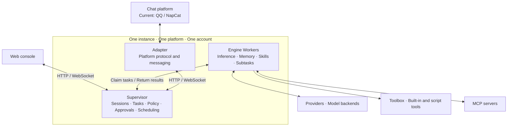

<div align="center">

**A framework for long-running AI bots, designed for multiple platform integrations.**

[](LICENSE)
[](#quick-start)
[](#platforms-and-instances)
[](#development)

[简体中文](README.md) · [English](README.en.md)

</div>

Conversations, long-term memory, tool calls, subtasks, and scheduled tasks, managed through a web console. Multiple QQ / NapCat instances are supported today; more chat platforms are planned.

[Platforms and instances](#platforms-and-instances) · [Core capabilities](#core-capabilities) · [Console](#console) · [Architecture](#architecture) · [Quick start](#quick-start) · [Configuration](#configuration) · [Deployment and upgrades](#deployment-and-upgrades) · [Permissions and security](#permissions-and-security) · [Development](#development)

## Platforms and instances

**One platform can have multiple instances. Each instance connects to one platform with one account.**

| Platform | Status |
|---|---|
| QQ / NapCat (OneBot 11) | Multiple instances with different accounts are supported; currently up to 9 instances per host, including the main instance |
| More chat platforms | Planned; future integrations will allow multiple platforms to coexist, each with multiple instances |

Manage instances and shared configuration groups under **Bot → Account & connections**. Put all instances in one group, share among separate groups, or keep them independent. Future integrations will follow the same model across platforms.

| Content | Sharing |
|---|---|
| Entire `config/` directory | Group members share persona, model channels and API keys, nodes, runtime settings, skills, tools, MCP, permission policy, and platform configuration; changes affect the whole group |
| Runtime data in `data/`, including memory, sessions, and chat history | Always separate for each instance |
| Account identity, platform tokens, ports, and paths | Always separate, in each instance's `.env` and `data/platform_secrets.yaml` |
| Sticker library | Shared by instances on the same host |

Joining a group archives the previous configuration. Leaving copies the group's current configuration, without restoring the version from before joining. Deleting an instance archives its workspace. Switching QQ accounts isolates memory by account; switching back restores access to that account's memory.

## Core capabilities

| Category | Capabilities |
|---|---|
| Model integrations | OpenAI / Responses, Anthropic, Gemini, and DeepSeek; multiple channels and fallback chains |
| Conversations and collaboration | Full current-session history, context compaction, original-message archives, subtasks, and specialized nodes |
| Memory | Long-term memory, user profiles, retrieval, and scheduled maintenance |
| Tools | Web search, page fetch, file access, shell commands, symbolic math, market quotes, custom tools, and MCP |
| Image generation | NovelAI, Gemini, and GPT Image, with presets and configurable parameters |
| Automation | Cron schedules, reminders, and script tasks |
| QQ interactions | Images and files, nested forwarded messages, quoted replies, @ mentions, progress reactions, slash commands, and sticker collection and review |

QQ replies to @ mentions by default. Names, keywords, probability, model-based decisions, and cooldowns are configurable. The console tests trigger rules using the actual decision logic. Platform-specific capabilities come from each adapter.

Conversation history is no longer partitioned or filtered by topic. The model receives the current session's history and existing summaries. Compaction replaces only the messages actually supplied to the summarizer and preserves messages appended while it runs. Sessions and instances remain separate.

Original messages, timestamps, tool arguments, and results are saved before compaction in each instance's `data/context_archive.sqlite3`. The model can search its own session with `search_context_archive` and page through results with `read_context_archive`. **Memory → Context archives** controls retention through `engine.context_archive.retention_days`, defaulting to seven days from archive creation. Expired archives become unavailable immediately and are deleted by scheduled cleanup; active history and summaries are unaffected. Resetting or deleting a session also deletes its archives. Previously discarded originals cannot be recovered.

## Console

The chat view shows replies, tool calls, approvals, and subtasks. Settings are grouped by purpose:

| Group | Main settings |
|---|---|
| General / Client | Browser connection, administrator login, and client preferences |
| Bot | **Account & connections**, persona, global defaults, memory, stickers, community collaboration, conversations and replies, and reminders |
| Models and providers | Providers, credentials, model parameters, vision channels, and fallback chains |
| Engine | Runtime diagnostics, approvals, nodes, tools and permissions, image generation, skills, MCP, and automation |
| Platform | The current platform's channels, triggers, permissions, input/output, interactions, and connection status |

**Account & connections** is a separate page alongside **Persona**, managing instances, shared configuration, and bot accounts. **General** manages the current browser's access to the console.

## Architecture

The platform adapter handles connections and messaging, Supervisor manages sessions and tasks, and Engine runs inference and tools. The diagram shows one instance; each instance runs its own processes, whether on the same platform or on a future integration.



The current QQ adapter uses `bot.py`, NoneBot2, and OneBot 11, connecting to NapCat through a reverse WebSocket. Future platforms will provide their own adapters and reuse the core capabilities and console. Reusing the memory implementation does not mean sharing memory data.

## Quick start

These steps use the currently supported QQ / NapCat integration. You need a QQ account and a model API key.

### Server installation

On a fresh Debian 12 / Ubuntu server, use the deployment script. The system's `python3` must be version 3.11 or later, and the installation path must be `/opt/kazebot`:

```bash
sudo git clone https://github.com/alksdesu/kazebot.git /opt/kazebot
sudo /opt/kazebot/deploy/bootstrap.sh
```

The script installs dependencies, builds the frontend, and configures NapCat and systemd. Open the console link it prints when finished. For remote access, first create an SSH tunnel:

```bash
ssh -L 8765:127.0.0.1:8765 <user>@<server-ip>
```

For an existing deployment, read the [data-preserving upgrade guide](deploy/UPGRADE-MULTI-PLATFORM.md) first.

<details>
<summary>Run locally (Python 3.11+, Node.js 18+, and a separate NapCat setup)</summary>

Run these Bash commands from the project root:

```bash
python -m venv .venv
source .venv/bin/activate
pip install -r requirements.txt

mkdir -p config
cp defaults/models.example.yaml config/models.yaml
cp defaults/policy.example.yaml config/policy.yaml
cp defaults/qq.example.yaml config/qq.yaml
cp .env.example .env

npm --prefix adapters/web/frontend ci
npm --prefix adapters/web/frontend run build
python main.py
```

In another terminal, start the QQ adapter from the project root:

```bash
.venv/bin/python bot.py
```

On first start, Supervisor logs a console link containing a token. See the [deployment guide](deploy/INSTALL.md) for NapCat connection settings.

</details>

### Initial configuration

| Order | Console location | What to configure |
|---|---|---|
| 1 | Models and providers → Providers | Model endpoint, API key, and model name |
| 2 | Bot → Account & connections | Scan the QR code to log in to QQ |
| 3 | Platform → QQ·NapCat → Permissions | Administrator QQ numbers |
| 4 | Platform → QQ·NapCat → Channels | Groups where the bot may respond |

The group allowlist and administrator list start empty: one determines where the bot responds, the other grants administrator access and approval handling. After saving or applying settings, check their loading status, then @ the bot in a group to test it. Switching accounts restarts NapCat and temporarily disconnects QQ.

## Configuration

`defaults/` contains defaults updated with the code, `config/` holds instance overrides or shared group configuration, and `data/` holds instance runtime data. Configuration and credentials stay out of the repository.

| Location | Purpose |
|---|---|
| `config/models.yaml`, `config/secrets.env` | Model channels and shareable model and tool credentials |
| `config/features.yaml`, `config/qq.yaml` | Platform-neutral defaults and QQ overrides |
| `config/nodes/`, `config/runtime.yaml` | Node definitions and runtime settings; nodes override files with the same name, runtime overrides individual keys |
| `config/policy.yaml` | Permission and approval policy |
| `config/skills/`, `config/tools/`, `config/mcp.yaml`, `config/drawtools/` | Skills, custom tools, MCP, and image generation settings |
| `.env`, `data/platform_secrets.yaml` | Instance environment and platform identity, kept separate |

Models and policy apply on subsequent reads; nodes load for new tasks. The QQ page shows the adapter's configuration loading status. Startup settings such as engine concurrency, polling intervals, HTTP timeouts, and instance environment require a restart. Refresh the MCP tool list by explicitly reloading MCP or restarting the engine.

<details>
<summary>Configuration precedence and compatibility</summary>

- `config/features.yaml` overrides matching feature settings in `.env`; include only the values you want to override. `config/qq.yaml` can override those platform-neutral settings further.
- For model and tool credentials, `.env` takes precedence over `config/secrets.env`. Platform tokens use `data/platform_secrets.yaml` first, then the corresponding environment variable.
- Scripts in `config/tools/` override repository tools at the same relative path. Nodes and runtime keys without overrides continue to use `defaults/`.
- If QQ or platform-neutral configuration fails to parse, the adapter keeps the last valid values. The console shows sources and loading status; administrators can also query `GET /v1/platforms/qq/config/state`.
- Conversation defaults and individual conversation overrides live in instance runtime data. Upgrades preserve existing settings.
- The old layout automatically copies configuration to the new locations without overwriting existing destinations. Old files do not receive later changes and must not overwrite data created after the upgrade.

</details>

## Deployment and upgrades

Production services run under systemd; Docker runs NapCat. Use the guide for your task:

| Task | Documentation |
|---|---|
| Installation, connections, and troubleshooting | [Deployment guide](deploy/INSTALL.md) |
| Multiple instances, ports, and shared configuration | [Instance management](deploy/MULTI-ACCOUNT.md) |
| Upgrades, migration, and rollback while preserving live data | [Data-preserving upgrade guide](deploy/UPGRADE-MULTI-PLATFORM.md) |
| Sticker collection, review, and storage | [Sticker guide](deploy/STICKERS.md) |

**Before upgrading, back up code, configuration, identity information, and every instance's data, including the actual shared configuration directories.** `deploy/deploy.sh` defaults to `reset --hard origin/master`; it does not automatically restore every local patch to tracked files. It also does not handle complete data backups, Python dependencies, systemd unit updates, or restarting all instances. Script success or a running process alone does not confirm a successful deployment.

## Permissions and security

- Ordinary users can chat, search, and generate images. General server file operations, commands, and restarts require administrator access; public read-only `curl` requests have a restricted channel.
- Sensitive operations follow approval policy. Administrators cannot bypass explicit deny rules; an empty QQ administrator list auto-denies approvals.
- Credentials are protected by access and outbound-file policies. QQ identities presented to models use aliases; local identity mappings, chat history, and logs still need to be protected as sensitive data.
- systemd uses a dedicated user and filesystem protections, but the main instance can still write source files under `/opt/kazebot` by default. The console binds to localhost; use an SSH tunnel or an authenticated reverse proxy for remote access.

## Development

| Directory | Responsibility |
|---|---|
| `supervisor/`, `engine/` | Scheduling and state, inference and execution |
| `platforms/`, `adapters/`, `clonoth_sdk/` | Platform capabilities, protocol adapters, console, and client protocol |
| `providers/`, `toolbox/`, `tools/` | Model backends and tool runtime |
| `defaults/`, `deploy/`, `tests/` | Default configuration, deployment, and backend tests |

```bash
python -m pip install -r requirements-dev.txt
python -m pytest
npm --prefix adapters/web/frontend run test:run
npm --prefix adapters/web/frontend run build
```

## Acknowledgements and license

- [HCPTangHY/Clonoth](https://github.com/HCPTangHY/Clonoth) — the framework this project is built on
- [qianzhuowo/Clonoth](https://github.com/qianzhuowo/Clonoth) — features contributed by the fork
- 秋雨·月落 — the OneBot adapter
- [astrbot_plugin_smart_imagechat_hub](https://github.com/QingchenWait/astrbot_plugin_smart_imagechat_hub) — reference for the sticker feature

This project is licensed under [GPL-3.0](LICENSE).
