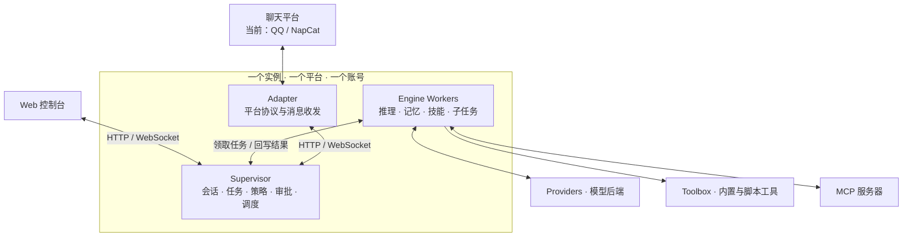

<div align="center">

**面向多平台接入、可长期运行的 AI 机器人框架。**

[](LICENSE)
[](#快速开始)
[](#平台与实例)
[](#开发)

[简体中文](README.md) · [English](README.en.md)

</div>

提供对话、长期记忆、工具调用、子任务和定时任务，通过 Web 控制台管理。当前已支持 QQ / NapCat 多实例，后续会适配更多聊天平台。

[平台与实例](#平台与实例) · [核心能力](#核心能力) · [控制台](#控制台) · [架构](#架构) · [快速开始](#快速开始) · [配置](#配置) · [部署与升级](#部署与升级) · [权限与安全](#权限与安全) · [开发](#开发)

## 平台与实例

**一个平台可以有多个实例，每个实例只连接一个平台、登录一个账号。**

| 平台 | 状态 |
|---|---|
| QQ / NapCat（OneBot 11） | 已支持多个实例，分别登录不同账号；当前同机最多 9 个实例，含主实例 |
| 更多聊天平台 | 后续适配，届时可同时运行多个平台、每个平台的多个实例 |

在「机器人 → 账号与连接」中管理实例和共享配置组。可以让所有实例加入同一个组、分组共享，或完全独立；未来不同平台的实例也会沿用这一模式。

| 内容 | 共享方式 |
|---|---|
| 整套 `config/` 配置 | 同组共用人格、模型渠道与 API 密钥、节点、运行参数、技能、工具、MCP、权限策略和平台配置；改动影响全组 |
| 记忆、会话、聊天历史等 `data/` 运行数据 | 始终按实例独立 |
| 账号登录身份、平台连接令牌、端口和路径 | 始终独立，保存在各实例的 `.env` 和 `data/platform_secrets.yaml` |
| 表情包图库 | 同一台机器上的实例共用 |

加入共享组会归档原配置；退出时复制组内当前配置，不恢复加入前的版本。删除实例会归档工作区。QQ 换号时记忆按账号隔离，换回后可继续使用原记忆。

## 核心能力

| 类别 | 能力 |
|---|---|
| 模型接入 | OpenAI / Responses、Anthropic、Gemini、DeepSeek，多渠道与备用链 |
| 对话与协作 | 当前会话完整历史、上下文压缩、原文归档检索、子任务与专职节点 |
| 记忆 | 长期记忆、人物资料、检索与定期整理 |
| 工具 | 联网搜索、网页读取、文件读写、命令执行、符号计算、行情查询、自定义工具与 MCP |
| 绘图 | NovelAI、Gemini、GPT Image，支持预设与参数配置 |
| 自动化 | Cron 定时任务、提醒、脚本任务 |
| QQ 交互 | 图片与文件、嵌套合并转发、引用回复、@ 提及、进度表情、斜杠命令、表情包收集与审核 |

QQ 接入默认由 @ 触发，也可配置名称、关键词、概率或模型判定，并设置冷却；控制台支持用实际判定逻辑测试触发规则。平台特有能力会随各适配器提供。

当前会话不再按 topic 分桶或过滤。模型读取当前会话的历史与已有摘要；压缩只替换实际送入摘要模型的消息，期间追加的消息继续保留，不跨会话或实例合并。

压缩前原文保存在各实例的 `data/context_archive.sqlite3`，保留消息时间、工具参数和结果。模型可用 `search_context_archive` 按关键词、原始时间检索，再用 `read_context_archive` 分页读取当前会话归档。在「记忆 → 压缩上下文归档」设置保留天数，默认 7 天，从归档创建时计算，对应 `engine.context_archive.retention_days`。过期归档不可检索并由定期清理删除；当前会话和摘要不受此期限影响。重置或删除会话也会删除其归档。旧版本压缩时已经丢失的原文无法恢复。

## 控制台

对话页展示回复、工具调用、审批和子任务；设置页按用途分类：

| 分组 | 主要内容 |
|---|---|
| 通用 / 客户端 | 浏览器连接、管理员登录、客户端偏好 |
| 机器人 | **账号与连接**、人格、全局默认、记忆、表情包、群协作、会话与接话、提醒 |
| 模型与渠道 | 服务商、密钥、模型参数、视觉渠道与备用链 |
| 引擎 | 运行诊断、审批、节点、工具与权限、绘图、技能、MCP、自动化 |
| 平台 | 当前平台的信道、触发、权限、输入输出、互动与链路状态 |

「账号与连接」与「人格」同级，负责实例、共享配置和机器人账号；「通用」管理当前浏览器对控制台的访问。

## 架构

平台适配器负责连接与收发，Supervisor 管理会话和任务，Engine 执行推理与工具。下图是一套实例的结构；同一平台或未来不同平台的实例均各自运行这套进程。



当前 QQ 适配由 `bot.py`、NoneBot2 和 OneBot 11 实现，通过反向 WebSocket 连接 NapCat。后续平台将提供各自的适配器，复用核心能力与控制台；复用记忆管理的实现不代表共享记忆数据。

## 快速开始

以下为当前 QQ / NapCat 接入方式，需要 QQ 账号和模型 API key。

### 服务器安装

全新 Debian 12 / Ubuntu 服务器可使用部署脚本，系统的 `python3` 需为 3.11+，安装目录固定为 `/opt/kazebot`：

```bash
sudo git clone https://github.com/alksdesu/kazebot.git /opt/kazebot
sudo /opt/kazebot/deploy/bootstrap.sh
```

脚本安装依赖、构建前端并配置 NapCat 与 systemd。装完按输出链接进入控制台；远程访问可先建立 SSH 隧道：

```bash
ssh -L 8765:127.0.0.1:8765 <用户>@<服务器IP>
```

已有部署升级请先看[数据保全升级指南](deploy/UPGRADE-MULTI-PLATFORM.md)。

<details>
<summary>本地运行（Python 3.11+、Node.js 18+，自行准备 NapCat）</summary>

以下命令使用 Bash，在项目根目录执行：

```bash
python -m venv .venv
source .venv/bin/activate
pip install -r requirements.txt

mkdir -p config
cp defaults/models.example.yaml config/models.yaml
cp defaults/policy.example.yaml config/policy.yaml
cp defaults/qq.example.yaml config/qq.yaml
cp .env.example .env

npm --prefix adapters/web/frontend ci
npm --prefix adapters/web/frontend run build
python main.py
```

另开一个终端，在项目根目录启动 QQ 适配器：

```bash
.venv/bin/python bot.py
```

首次启动时，Supervisor 日志会输出带 token 的控制台链接。NapCat 的连接配置见[部署指南](deploy/INSTALL.md)。

</details>

### 首次配置

| 顺序 | 控制台入口 | 配置内容 |
|---|---|---|
| 1 | 模型与渠道 → 渠道 | 模型地址、API key、模型名 |
| 2 | 机器人 → 账号与连接 | 扫码登录 QQ |
| 3 | 平台 → QQ·NapCat → 权限 | 管理员 QQ 号 |
| 4 | 平台 → QQ·NapCat → 信道 | 允许响应的群号 |

群白名单和管理员名单默认为空：前者决定在哪些群响应，后者决定管理员权限与审批。保存或应用后查看配置生效状态，再到群里 @ 机器人测试。换号会重启 NapCat，期间 QQ 连接暂时不可用。

## 配置

`defaults/` 是随代码更新的默认值，`config/` 保存实例覆盖或共享组配置，`data/` 保存实例运行数据。配置和密钥不进入仓库。

| 位置 | 用途 |
|---|---|
| `config/models.yaml`、`config/secrets.env` | 模型渠道与可共享的模型、工具密钥 |
| `config/features.yaml`、`config/qq.yaml` | 通用功能默认值与 QQ 覆盖项 |
| `config/nodes/`、`config/runtime.yaml` | 节点定义与运行参数；节点按同名文件覆盖，runtime 按键覆盖 |
| `config/policy.yaml` | 权限与审批策略 |
| `config/skills/`、`config/tools/`、`config/mcp.yaml`、`config/drawtools/` | 技能、自定义工具、MCP 与绘图配置 |
| `.env`、`data/platform_secrets.yaml` | 实例环境与平台身份，保持独立 |

模型和策略在后续读取时生效，节点在新任务加载时生效，QQ 页面显示适配器加载状态。引擎并发数、轮询间隔、HTTP 超时及实例环境等启动项需要重启；MCP 工具列表需显式重载 MCP 或重启引擎。

<details>
<summary>配置优先级与兼容说明</summary>

- `config/features.yaml` 比 `.env` 中的同名功能设置优先；只填写需要覆盖的项即可。`config/qq.yaml` 可进一步覆盖通用功能项。
- 模型与工具密钥中，`.env` 的同名值优先于 `config/secrets.env`；平台令牌优先读取 `data/platform_secrets.yaml`，再回退到对应环境变量。
- `config/tools/` 的同路径脚本覆盖仓库 `tools/` 版本；未覆盖的节点与 runtime 键继续使用 `defaults/`。
- QQ 或通用功能配置解析失败时继续使用上一份有效值。控制台显示来源与加载状态，也可通过管理员接口 `GET /v1/platforms/qq/config/state` 查询。
- 会话默认值与单个会话覆盖保存在实例运行数据中，升级会保留已有设置。
- 旧布局会自动复制配置到新位置，不覆盖已有目标。旧文件不接收后续修改，不能直接用于覆盖升级后的数据。

</details>

## 部署与升级

生产使用 systemd 管理服务，Docker 运行 NapCat。详细操作按场景查阅：

| 场景 | 文档 |
|---|---|
| 安装、连接与排障 | [部署指南](deploy/INSTALL.md) |
| 多实例、端口与共享配置 | [多实例管理](deploy/MULTI-ACCOUNT.md) |
| 保留线上数据升级、迁移与回滚 | [数据保全升级指南](deploy/UPGRADE-MULTI-PLATFORM.md) |
| 表情包收集、审核与存储 | [表情包指南](deploy/STICKERS.md) |

**升级前备份代码、配置、身份信息和各实例数据，包括共享配置实际目录。** `deploy/deploy.sh` 默认执行 `reset --hard origin/master`，受跟踪文件的本地补丁不会全部自动恢复；它也不负责完整数据备份、Python 依赖、systemd 单元和所有实例的重启。不能仅凭脚本成功或进程存在判断上线完成。

## 权限与安全

- 普通用户可用聊天、搜索和绘图等功能；一般服务器文件操作、命令执行和重启限管理员，公网只读 `curl` 有受限通道。
- 敏感操作按策略审批，管理员也不能绕过明确拒绝的规则；QQ 管理员名单为空时，审批自动拒绝。
- 密钥受访问与发送策略保护，提供给模型的 QQ 身份使用匿名标识；本地身份映射、聊天记录和日志仍需按敏感数据保护。
- systemd 使用专用用户及文件系统保护，但主实例默认仍可写 `/opt/kazebot` 中的源码。控制台默认绑定本机，远程访问使用 SSH 隧道或带认证的反向代理。

## 开发

| 目录 | 职责 |
|---|---|
| `supervisor/`、`engine/` | 调度与状态、推理与执行 |
| `platforms/`、`adapters/`、`clonoth_sdk/` | 平台能力、协议适配、控制台与客户端协议 |
| `providers/`、`toolbox/`、`tools/` | 模型后端与工具运行时 |
| `defaults/`、`deploy/`、`tests/` | 默认配置、部署与后端测试 |

```bash
python -m pip install -r requirements-dev.txt
python -m pytest
npm --prefix adapters/web/frontend run test:run
npm --prefix adapters/web/frontend run build
```

## 致谢与许可

- [HCPTangHY/Clonoth](https://github.com/HCPTangHY/Clonoth) —— 本项目的框架
- [qianzhuowo/Clonoth](https://github.com/qianzhuowo/Clonoth) —— 感谢修改版提供的功能
- 秋雨·月落 —— 感谢提供 OneBot 适配器
- [astrbot_plugin_smart_imagechat_hub](https://github.com/QingchenWait/astrbot_plugin_smart_imagechat_hub) —— 表情包功能参考

本项目使用 [GPL-3.0](LICENSE) 许可。
